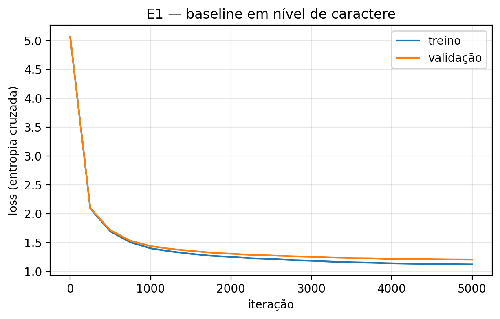
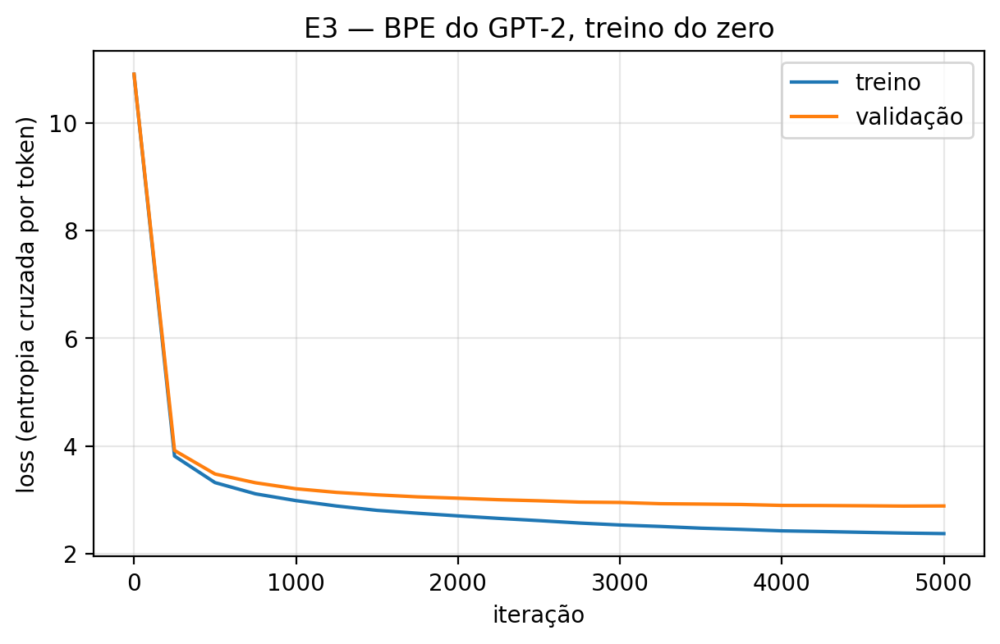
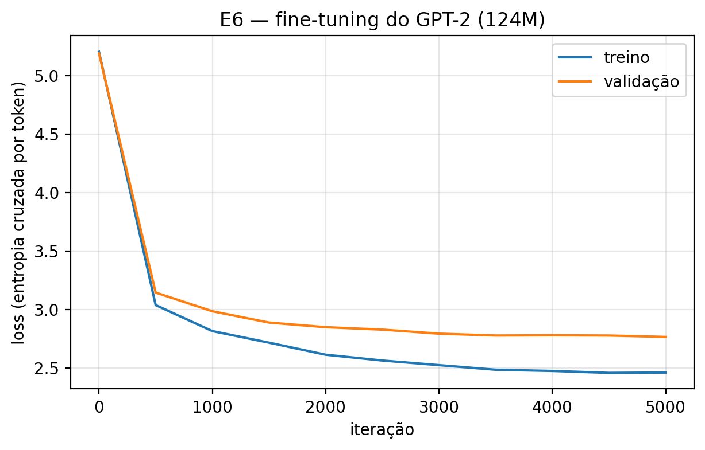

# MachadoGPT

Modelos de linguagem estilo GPT-2 treinados sobre a obra original de Machado de Assis,
usando o [nanoGPT](https://github.com/karpathy/nanoGPT).

Projeto Individual 1 de Redes Neurais e Aprendizado Profundo (UnB, 2026/2, Prof. Díbio Leandro Borges).
Autor: Roberto Ribeiro Corrêa De Oliveira Neto (242009936).

📄 **Relatório:** [`artigo.pdf`](artigo.pdf)

## Resultados

Três experimentos com o mesmo orçamento de treino (5000 iterações × 16 384 tokens, GPU T4),
comparados em bits por caractere (BPC) no conjunto de validação:

| Modelo | Tokenização | Pesos iniciais | Parâmetros | Perda val. | BPC |
|--------|-------------|----------------|-----------:|-----------:|----:|
| GPT-2 sem ajuste | BPE GPT-2 | GPT-2 124M | 123,7M | 5,192 | 2,975 |
| E1 | caractere | aleatórios | 10,7M | 1,204 | 1,737 |
| E3 | BPE GPT-2 | aleatórios | 29,9M | 2,885 | 1,653 |
| **E6** | BPE GPT-2 | GPT-2 124M | 123,7M | 2,767 | **1,586** |

As perdas de E1 (por caractere) e de E3/E6 (por token BPE) não são comparáveis diretamente;
o BPC normaliza pelo número de caracteres: `BPC = loss × (tokens / caracteres) / ln 2`.

| E1 | E3 | E6 |
|----|----|----|
|  |  |  |

## Estrutura

```
main.ipynb       pipeline completo: corpus, limpeza, divisão, tokenização, E1, E3 e E6
artigo.pdf       relatório final
resultados/      logs do train.py e curvas de perda de cada experimento
```

## Pipeline

1. **Corpus** — pacote `machado` do NLTK (*Obra Completa*, MEC / Nova Aguilar 1994),
   decodificado como Windows-1252 para preservar travessões e aspas curvas.
2. **Limpeza** — parágrafos contínuos, normalização NFC, remoção de cabeçalhos editoriais
   e de 33 sumários; as três traduções são excluídas. Resultado: 243 obras, 13,4M caracteres.
3. **Divisão** — por obra inteira, estratificada por gênero, com algoritmo guloso para
   aproximar 80/10/10% dos caracteres (evita vazamento de enredo entre conjuntos).
4. **Tokenização** — caractere (vocabulário de 144 símbolos, só do treino) e BPE do GPT-2 (`tiktoken`).
5. **Experimentos** — E1 e E3 mudam só a tokenização; E3 e E6 mudam só os pesos iniciais.

## Como executar

1. Abra `main.ipynb` no [Google Colab](https://colab.research.google.com/).
2. *Ambiente de execução → Alterar tipo de ambiente de execução → T4 GPU*.
3. Execute as células em ordem. Tempos aproximados na T4: E1 ≈ 10 min, E3 ≈ 30 min, E6 ≈ 1h40.

O notebook clona o nanoGPT fixado no commit `3adf61e` e instala o `tiktoken`;
as demais dependências (PyTorch, NLTK, NumPy, Matplotlib) já vêm no Colab.
Os checkpoints (`ckpt.pt`) não estão no repositório por excederem o limite de tamanho do GitHub.

## Atribuição

- **Terceiros:** arquitetura do modelo, laço de treino, carregamento dos pesos do GPT-2 e script
  de amostragem — [nanoGPT](https://github.com/karpathy/nanoGPT) (A. Karpathy, licença MIT);
  pesos do GPT-2 (OpenAI, via Hugging Face); tokenizador BPE (`tiktoken`, OpenAI).
  A tokenização em caractere foi adaptada de `shakespeare_char` e a codificação BPE, do
  `prepare.py` de `openwebtext`, ambos do nanoGPT.
- **Autoria própria:** download, limpeza e estatísticas do corpus; algoritmo de divisão por obra;
  vocabulário de caracteres a partir do treino; configurações dos experimentos; extração das
  curvas de treino e comparação em bits por caractere.
- **Textos:** obra de Machado de Assis (1839–1908), em domínio público.
